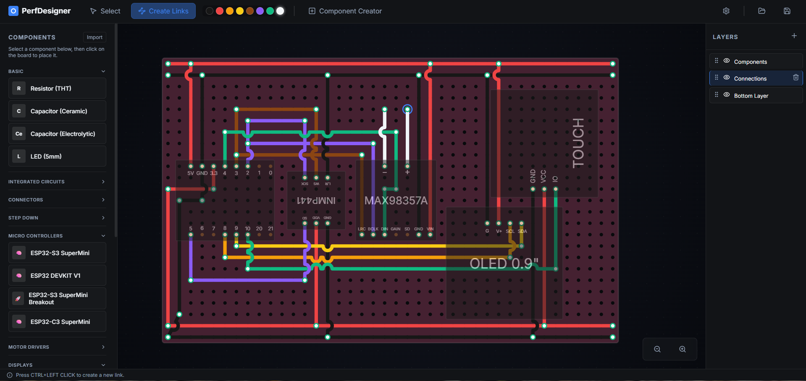

# Chikadora — ESP32-C3 Voice Assistant

Chikadora is a tap-to-talk voice assistant built on an **ESP32-C3 Supermini**.
You tap a touch pad, speak, and Chikadora transcribes your speech, asks a local
LLM for a reply, and speaks the answer back — all powered by a small local
server on your PC. Everything runs on your own machine: no cloud accounts, no
API keys.

```
      ┌──────────────────── ESP32-C3 (Chikadora) ─────────────────────┐
 tap →│  INMP441 mic ─▶ record 16kHz PCM                              │
      │                    │                                           │
      │                    ▼   POST /api/transcribe (WAV)              │
      │           ┌────────────────────────────────────────────┐       │
      │           │            Local server (PC)               │       │
      │           │  Whisper STT ─▶ text                       │      │
      │           │  Ollama chat ─▶ reply   (/api/chat)        │      │
      │           │  Kokoro TTS  ─▶ WAV jobs (/api/synthesize) │      │
      │           └────────────────────────────────────────────┘       │
      │                    │   GET /api/jobs/{id}/result (WAV)         │
      │                    ▼                                           │
      │  MAX98357 amp ◀─ play reply     SSD1306 shows a face          │
      └────────────────────────────────────────────────────────────────┘
```

Flow at speak time: **tap → record → transcribe (Whisper) → chat (Ollama) →
synthesize (Kokoro) → play**. Long replies are chopped into short clips that are
synthesized and played back to back, so playback stays smooth on the tiny MCU.

**Controls & pages.** The touch pad drives two gestures: **one tap = talk**,
**two taps = switch page**. There are two pages — an animated **face** (eyes +
mouth) and a **weather** page (current conditions + a short hourly forecast from
[Open-Meteo](https://open-meteo.com/), with animated icons). Almost everything is
configurable from a small **web page the device hosts itself** (see
[Device configuration](#device-configuration)) — no reflashing.

---

## 1. Hardware

| Component | Role |
|---|---|
| ESP32-C3 Supermini | MCU + Wi-Fi |
| INMP441 | I2S MEMS microphone (input) |
| MAX98357A | I2S class-D amplifier + speaker (output) |
| SSD1306 (128×64, I2C) | OLED face/status display |
| TTP223B | Capacitive touch pad (tap to talk) |

### Wiring

  

Navigate to [PerfDesigner](https://perfdesigner.vercel.app/) and download this file and open in PerfDesigner [chikadoraboard.json](https://github.com/jaysonragasa/ChikadoraAssistant/blob/main/perfboard/chikadoraboard.json)
  
The mic and amplifier **share** the I2S clock lines (`BCLK`/`LRC`) because the
C3 has a single I2S peripheral; the firmware installs/uninstalls the I2S driver
as it switches between recording and playback.

Pin assignments are defined in [`include/Config.h`](include/Config.h)
(`Config::Pins`):

| ESP32-C3 GPIO | Connects to | Notes |
|---|---|---|
| GPIO2 | INMP441 `SCK` **and** MAX98357 `BCLK` | shared I2S bit clock |
| GPIO3 | INMP441 `WS` **and** MAX98357 `LRC` | shared I2S word select |
| GPIO4 | MAX98357 `DIN` | I2S data out (to amp) |
| GPIO10 | INMP441 `SD` | I2S data in (from mic) |
| GPIO20 | SSD1306 `SDA` | I2C data |
| GPIO21 | SSD1306 `SCL` | I2C clock |
| GPIO5 | TTP223B `I/O` | touch signal |
| 3V3 | VDD/VCC of all modules | |
| 5V (or 3V3) | MAX98357 `VIN` | 5V is louder |
| GND | GND of all modules | common ground |

Extra module pins:
- **INMP441 `L/R` → GND** (selects the left channel; the mic is read as mono-left).
- **MAX98357 `GAIN`** — leave floating for 9 dB (default). `SD` (shutdown) can be left high/floating to keep the amp enabled.
- **SSD1306** I2C address is `0x3C`.

> The INMP441 is sensitive to a noisy 3.3 V rail. If recordings hiss, keep its
> wiring short and add a 0.1 µF cap across its VDD/GND.

---

## 2. Prerequisites

- **PC on the same LAN as the device** (Windows, in these instructions) to run the server.
- **Python 3.10+** for the server.
- **[Ollama](https://ollama.com/download)** for the LLM.
- **[PlatformIO](https://platformio.org/)** (VS Code extension or CLI) to build/flash the firmware.
- A USB-C cable for the ESP32-C3.

---

## 3. Set up the local server (Kokoro TTS + Whisper STT + Ollama chat)

The server lives in [`webserver/`](webserver/) and exposes the HTTP API the
firmware calls. Full details are in [`webserver/README.md`](webserver/README.md);
the essentials, run from the `webserver` folder:

```cmd
cd webserver

REM 1. Create the virtual environment
python -m venv venv
venv\Scripts\python.exe -m pip install --upgrade pip

REM 2. Install a CPU build of PyTorch (Kokoro depends on torch)
venv\Scripts\python.exe -m pip install torch --index-url https://download.pytorch.org/whl/cpu

REM 3. Install the rest of the dependencies
venv\Scripts\python.exe -m pip install -r backend\requirements.txt
```

Then start it:

```cmd
run.cmd
```

`run.cmd` binds to `0.0.0.0:8000` so the ESP32 can reach it over the LAN. Open
<http://127.0.0.1:8000> in a browser on the PC.

- **Kokoro TTS** weights (~350 MB) download on first use, or via the **Download**
  button in the web UI. The default voice is `af_sarah`.
- **Whisper STT** (`faster-whisper`, `base` model) downloads on first transcription.
- Synthesized audio is downsampled to **16 kHz** by default (`TTS_OUTPUT_RATE`)
  so clips are small enough to fit in the device's RAM.

> **Find this PC's LAN IP** (you'll need it for the firmware): run `ipconfig`
> and note the IPv4 address, e.g. `192.168.1.60`.

### Web UI features

- **Generate** speech from typed text (voice + speed) with a job **queue**.
- **Ollama** card — set the server URL, pick a model (**List** button), edit the
  system prompt, run a **Test chat**, and **Reset conversation**.
- **Received audio** card — plays back the last clips the device sent for
  transcription, so you can hear exactly what the mic captured (great for tuning
  `MIC_GAIN`).

---

## 4. Set up Ollama (the LLM)

1. **Install** Ollama from <https://ollama.com/download> and make sure it's running
   (it runs as a background service on Windows; `ollama serve` starts it manually).
2. **Pull a model.** A small model responds fastest on the device:
   ```cmd
   ollama pull llama3.2
   ```
3. **Select the model** in the web UI: open <http://127.0.0.1:8000>, go to the
   **Ollama** card, click **List**, pick your model, and **Save**. The status
   badge should read **connected**.
4. **Test** it with the "Test chat" box in the same card.

> Ollama listens on `http://localhost:11434` by default, which matches the
> server's default. The server reaches Ollama on the **PC**, not the device, so
> the ESP32 never talks to Ollama directly.

---

## 5. Configure and flash the firmware

All settings live in [`include/Config.h`](include/Config.h) as namespaced
`constexpr` defaults. You only **need** to edit the Wi-Fi credentials before the
first flash — everything else can be changed later from the device's own web
page (see [Device configuration](#device-configuration)).

```cpp
namespace Wifi {
    constexpr const char* SSID = "your-wifi-name";
    constexpr const char* PASS = "your-wifi-password";
}
namespace Server {
    constexpr const char* IP = "192.168.1.60";   // your PC's LAN IP (first-run default)
    constexpr uint16_t    PORT = 8000;
}
```

> **Config.h vs the web page.** `Config.h` holds the *first-run defaults*. On
> first boot the device seeds its NVS (flash) storage from these; after that the
> values saved from the web page win. Wi-Fi and pins are **bootstrap/hardware**
> settings and stay compile-time — the device needs Wi-Fi before it can serve
> its config page.

Build and flash (from the project root, with the device plugged in):

```cmd
uploadmon.cmd     REM build + upload + open serial monitor (115200 baud)
```

Or use PlatformIO directly:

```cmd
pio run                REM build only
pio run -t upload      REM build + flash
pio run -t monitor     REM serial monitor (115200)
```

`upload.cmd` is the same as `uploadmon.cmd` without the serial monitor.

---

## 6. Run it end to end

Start these in order:

1. **Ollama** is running and a model is pulled (step 4).
2. **Server** is running: `run.cmd` in `webserver/` (step 3), model selected in the UI.
3. **Device** is powered and on Wi-Fi (watch the serial monitor for the IP and
   `WiFi connected`).

Then: **tap the touch pad**, speak after the ding, and wait. The serial log
walks the whole pipeline:

```
Heard: what's the weather like on mars
Asking the LLM...
LLM: Mars is cold and dry, averaging about minus 60 Celsius.
Split reply into 2 clip(s).
[Clip 1/2] job a1b2...: "Mars is cold and dry, averaging"
[Clip 2/2] job c3d4...: "about minus 60 Celsius."
TTS Job done! Playing audio...
Next clip 2/2 (job c3d4...)
All clips played.
```

Turn **Send speech to the LLM** off on the config page to bypass the LLM and just
echo your speech (handy for testing the mic/speaker path).

---

## Controls

The single touch pad is gesture-based:

- **One tap → talk.** Records, transcribes, asks the LLM, and speaks the reply.
- **Two taps → switch page.** Toggles between the **face** and **weather** pages.

(Single vs double tap is disambiguated by a ~400 ms window, so a single tap acts
a beat after you lift your finger.) While recording, tap again to stop early;
it also stops automatically when the mic buffer fills (~4.5 s).

---

## Device configuration

Chikadora hosts its own config page — no reflashing, and it works even if the
TTS server is down. After it joins Wi-Fi, the OLED shows its IP (e.g.
`192.168.1.42`); open `http://<device-ip>/` from any browser on the same network.
Settings are stored in the device's NVS (flash); **most changes take effect
after a restart** (there's a "Restart now" button), except the eye sliders which
preview **live** on the screen as you drag.

| Section | Setting | Notes |
|---|---|---|
| **TTS / LLM server** | IP, Port | Where the device reaches the local server. Fixes a DHCP change without reflashing. |
| **Audio** | Voice | Any Kokoro voice id (e.g. `af_sarah`, `am_adam`). |
| | Mic gain | Clean multiplier over unity (~2–5). |
| | Speaker volume | 0 = silent, 1 = unity, >1 amplifies. |
| | Send speech to the LLM | Off = echo what you said. |
| | Speak a retry prompt when nothing is heard | Off = silent eye-shake only. |
| **Playback** | Mode | Stream (whole reply) or Chunk (split into clips). |
| | Words per chunk | Clip size in chunk mode. |
| **Face / Eyes** | Width, Distance, Height, Roundness | Sliders; **live preview** on the OLED. |
| | Show mouth | Toggle the smile. |
| **Overlays** | Show loop time / Show free memory | Small text in the top-left, drawn *behind* the eyes. |
| **Weather** | Enable, Latitude, Longitude, Refresh (min) | Powered by [Open-Meteo](https://open-meteo.com/). Set your coordinates. |

The device polls Open-Meteo every *Refresh* minutes (in the background while
idle) and shows current conditions plus a short hourly forecast on the weather
page, with animated icons (sun, clouds, rain, snow, storm, fog). If the TTS
server can't be reached at boot, a small **`!TTS`** badge shows on the face and
the device runs on its stored defaults.

---

## How playback works

The ESP32-C3 has little RAM and a single core, so real-time audio streaming
tends to stutter. Chikadora avoids that:

- **`PLAYBACK_CHUNK` (default):** the reply is split into ~`WORDS_PER_CHUNK`-word
  clips (broken at sentence boundaries when possible). All clips are queued to
  the server at once, so it synthesizes the next clip while the current one
  plays. Each clip is downloaded fully into RAM and then played — smooth and
  gap-free, with only short natural pauses between clips.
- **`PLAYBACK_STREAM`:** the whole reply is one job, streamed to I2S as it
  downloads. Handles any length with a fixed small buffer, but can stutter if
  the network hiccups. Flip `PLAYBACK_MODE` to try it.

Clips are kept small by the server's 16 kHz `TTS_OUTPUT_RATE`. If a clip is still
too big to fit in RAM it's skipped with a log line — lower `TTS_OUTPUT_RATE` or
`WORDS_PER_CHUNK` if you see that.

---

## Configuration reference

### Firmware ([`include/Config.h`](include/Config.h) defaults)

These are the compile-time **first-run defaults**; the live values are stored in
NVS and edited from the [device config page](#device-configuration). Wi-Fi and
`Pins` are bootstrap/hardware and can only change by reflashing.

| Namespace | Setting | Default | Web-editable? |
|---|---|---|---|
| `Wifi` | `SSID` / `PASS` | — | no (bootstrap) |
| `Server` | `IP` / `PORT` | `192.168.1.60` / `8000` | **yes** |
| `Server` | `VOICE_ID` | `af_sarah` | **yes** |
| `Audio` | `MIC_GAIN` | `3.0` | **yes** |
| `Audio` | `SPEAKER_VOLUME` | `3.0` | **yes** |
| `Audio` | `USE_LLM` | `true` | **yes** |
| `Audio` | `SPEAK_ON_NO_SPEECH` | `false` | **yes** |
| `Playback` | `MODE` | `Stream` | **yes** |
| `Playback` | `WORDS_PER_CHUNK` | `10` | **yes** |
| `Eyes` | `WIDTH`/`HEIGHT`/`GAP`/`ROUNDNESS`/`SHOW_MOUTH` | `30`/`34`/`27`/`8`/`true` | **yes** (live) |
| `Weather` | `ENABLED`/`LAT`/`LON`/`POLL_MINUTES` | `true`/`14.5995`/`120.9842`/`30` | **yes** |
| `Overlay` | `SHOW_LOOPTIME`/`SHOW_FREEMEM` | `false`/`false` | **yes** |
| `Pins` | I2S/I2C/touch GPIOs | see table above | no (hardware) |

The mic capture also runs a DC-blocking high-pass to keep speech sharp, and
drains the I2S DMA on every loop so it never falls behind the 16 kHz capture
rate (which used to drop samples and cause pops). Recording length is capped by
the mic buffer (`maxBufferSize` in `include/I2SMicrophone.h`, 144000 bytes ≈
**4.5 s** at 16 kHz); tap again to stop early. It auto-shrinks if the heap is low.

**Empty transcription behavior** — the **Speak a retry prompt** setting (device
config page; `Config::Audio::SPEAK_ON_NO_SPEECH` default) controls what happens
when nothing is transcribed: on = shake the eyes **and** speak the
`Messages::NO_SPEECH` retry prompt; off = just shake the eyes and return to idle.
Even when on, it falls back to a silent eye-shake if the TTS job can't be queued
(e.g. the server is down).

### Server environment variables

| Variable | Default | Purpose |
|---|---|---|
| `TTS_HOST` | `127.0.0.1` (`run.cmd` sets `0.0.0.0`) | Bind address |
| `TTS_PORT` | `8000` | Port |
| `TTS_DEVICE` | `cpu` | `cuda:0` on a GPU box |
| `TTS_OUTPUT_RATE` | `16000` | TTS output sample rate. Lower (`12000`/`8000`) shrinks clips so more fits in the device's RAM; higher is crisper but bigger |
| `STT_ENGINE` | `faster-whisper` | STT engine: `faster-whisper` or `moonshine` (fast, short-English) |
| `STT_MODEL` | `base` | faster-whisper size (`tiny`/`base`/`small`/...) |
| `MOONSHINE_MODEL` | `UsefulSensors/moonshine-base` | Moonshine HF repo (`...moonshine-tiny` for smaller/faster) |
| `STT_LANGUAGE` | `en` | Forced language for faster-whisper (`auto` to detect) |
| `STT_VAD` | `0` | `1` re-enables the VAD filter (faster-whisper) |
| `OLLAMA_HOST` | `http://localhost:11434` | Ollama server URL |
| `OLLAMA_MODEL` | `llama3.2` | Model name (override in the UI) |
| `SAVE_RECORDINGS` | `1` | Keep the last 20 clips the device sent (playable in the web UI's "Received audio" card); set `0` to disable |

Ollama host/model/system-prompt are also editable in the web UI and saved to
`webserver/backend/settings.json` (gitignored). Device-side settings (voice,
audio, eyes, weather, overlays, server IP/port) live on the **device's** config
page, not the server — so the server UI only covers TTS generation and Ollama.

---

## Troubleshooting

**Device reboots when audio starts playing.** Fixed — the mic buffer is freed
before playback so the audio path has enough heap. Make sure you're on a current
build (`uploadmon.cmd`).

**Playback is choppy/laggy.** Use `PLAYBACK_CHUNK` (the default). If you're on
`PLAYBACK_STREAM`, switch back — streaming stutters on this MCU.

**A long reply cuts out / "Not enough contiguous heap" in the log.** A clip was
too big for RAM. Lower `TTS_OUTPUT_RATE` (e.g. 12000) or `WORDS_PER_CHUNK`.

**Mic sounds grainy / not sharp, or transcripts are wrong.** `MIC_GAIN` is now a
clean multiplier over unity — if speech clips/distorts, lower it (toward 2); if
too quiet, raise it (4–5). Use the **Received audio** card to listen back and
tune. Speak within ~4.5 s per tap.

**Popping / clicking in the recording while speaking.** Fixed — the mic capture
now drains the I2S DMA fully on every `update()` call instead of reading a single
128-sample chunk per loop iteration. Reading one small chunk per `~10 ms` loop
fell behind the 16 kHz capture rate, so the DMA overflowed and dropped samples,
heard as pops/clicks (worst during continuous sound, i.e. while talking). Make
sure you're on a current build.

**"Could not reach Ollama..."** Ollama isn't running or the URL is wrong. Start
it (`ollama serve`) and confirm the **Ollama** card shows **connected**.

**"Ollama model '…' isn't installed."** Run `ollama pull <model>`, then pick it
via **List** in the UI and **Save**.

**Nothing happens / can't reach the server / `!TTS` badge on the face.** The
device couldn't reach the TTS server. Open the device config page
(`http://<device-ip>/`, IP shown on boot) and check the **Server IP/Port** match
the PC's current LAN IP (`ipconfig`); confirm the server is running (`run.cmd`)
and the PC firewall allows inbound connections on port 8000. Restart the device
after saving.

**Serial monitor shows nothing.** Baud is `115200`; the C3 Supermini needs USB
CDC (already enabled via `build_flags` in `platformio.ini`).

---

## Project layout

```
ChikadoraAssistant/
├─ platformio.ini            PlatformIO config (board, libs, USB CDC)
├─ upload.cmd / uploadmon.cmd  build + flash helpers
├─ include/                  interfaces + implementations' headers
│  ├─ Config.h               compile-time first-run defaults (wifi, server, audio, eyes, weather, pins)
│  ├─ RuntimeSettings.h      mutable settings struct (seeded from Config, loaded from NVS)
│  ├─ DeviceConfig.h         NVS-backed persistent config (server addr + all runtime settings)
│  ├─ IDisplay/IAudio*/IApiClient/ITouchSensor/IWeatherProvider   abstractions (DIP)
│  ├─ OledFaceDisplay.h      face + boot screens + weather page + overlays
│  ├─ WebConfigServer.h      device-hosted config page (port 80)
│  ├─ TapDetector.h          single/double-tap gesture detection
│  ├─ WeatherData.h / OpenMeteoClient.h   weather model + Open-Meteo client
│  └─ VoiceAssistant.h       state machine + paging + weather poll (composition target)
├─ src/                      main.cpp (composition root) + implementations
└─ webserver/                local TTS/STT/LLM server (see webserver/README.md)
   ├─ backend/               FastAPI app: Kokoro TTS, Whisper STT, Ollama chat
   ├─ frontend/              web UI (generate, Ollama settings, received audio, queue)
   └─ run.cmd                start the server on 0.0.0.0:8000
```

The firmware follows a SOLID layout: `main.cpp` is a thin composition root that
builds the concrete devices (OLED, mic, amp, touch, TTS client, weather client)
and injects them into `VoiceAssistant`, which depends only on the interfaces.

---

## Security note

The server binds to your LAN with **no authentication** — anyone on the network
can hit its endpoints (including `/api/chat`). That's fine for a trusted home
network; don't expose port 8000 to the internet.
